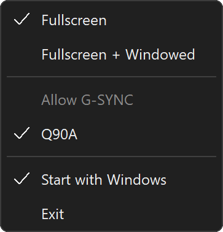

# GsyncStatusTrayToggle

A Windows tray app that shows the NVIDIA G-SYNC state and turns it on or off with one click.

Not affiliated with NVIDIA.

## Features

- Tray icon shows the current state: Off, Fullscreen or Fullscreen + Windowed.
- One-click toggle that follows the NVIDIA Control Panel's sequence.
- Stays in sync with changes made in the NVIDIA Control Panel or other tools.
- Allows or disallows G-SYNC for each display model, like **Enable settings for the selected display model** in the NVIDIA Control Panel.
- Command line support.

| | Off | Fullscreen | Fullscreen + Windowed |
| --- | :---: | :---: | :---: |
| Dark taskbar |  |  |  |
| Light taskbar |  |  |  |

## Requirements

- Windows 10 version 1607 or later, or Windows 11, 64-bit.
- An NVIDIA GPU with a G-SYNC or G-SYNC Compatible display.

## Usage

Download the zip from the Releases page, extract it and run `GsyncStatusTrayToggle.exe`. The program is not signed: if SmartScreen warns, choose **More info**, then **Run anyway**.

- **Left-click:** G-SYNC on or off.
- **Right-click:** Fullscreen, Fullscreen + Windowed, Allow G-SYNC, Start with Windows, Exit.



### Allow G-SYNC on a display

**Allow G-SYNC** lists the displays that offer VRR, one line per model: identical displays share one line. A checked display can use G-SYNC. This is the same choice as **Enable settings for the selected display model** in the NVIDIA Control Panel, and each one shows the change made in the other.

- NVIDIA accepts this choice only while G-SYNC is on. The lines are grayed out while it is off.
- A display whose VRR is off in its own menu is not listed. It appears once VRR is turned on there.
- When G-SYNC is on but not allowed on a display, the tray tooltip says so.
- Some displays keep showing VRR in their own menu after G-SYNC is disallowed. The NVIDIA Control Panel gives the same result.
- Changing the choice can make the display go black for about a second.

### Command line

| Command | Result |
| --- | --- |
| `GsyncStatusTrayToggle.exe /off` | G-SYNC off |
| `GsyncStatusTrayToggle.exe /fs` | G-SYNC on, fullscreen only |
| `GsyncStatusTrayToggle.exe /fsw` | G-SYNC on, fullscreen and windowed |
| `GsyncStatusTrayToggle.exe /allow NAME` | Allow G-SYNC on the display model `NAME` |
| `GsyncStatusTrayToggle.exe /disallow NAME` | Disallow G-SYNC on the display model `NAME` |
| `GsyncStatusTrayToggle.exe /list \| more` | List the NVIDIA displays, their model code and their choice |

`NAME` is the display name shown by Windows, such as `Q90A`, or its model code from `/list`, such as `SAM713F`. Case does not matter. Put a name with spaces in quotes: `/allow "ASUS MG28U"`. G-SYNC must be on. A display whose VRR is off in its own menu keeps the choice until VRR is turned on there.

The program has no console window, so a command prompt does not wait for it: `/list` would print after the next prompt. `| more` makes the prompt wait. In a `.cmd` script, every command waits.

```
Display     Model    G-SYNC       VRR
Q90A        SAM713F  allowed      available
ASUS MG28U  ACI28A7  not allowed  not available
```

| Exit code | Meaning |
| --- | --- |
| 0 | Success |
| 1 | The G-SYNC lock could not be opened |
| 2 | Another G-SYNC command is still running |
| 3 | The G-SYNC lock could not be acquired |
| 10 | NVAPI could not be initialized (NVIDIA driver missing?) |
| 11 | The NVIDIA settings could not be opened |
| 12 | The NVIDIA settings could not be loaded |
| 13 | The NVIDIA global profile could not be opened |
| 14 | A G-SYNC setting could not be read, or its value is unknown. Nothing was changed |
| 15 | NVIDIA rejected the change. Part of it may already be saved |
| 16 | The NVIDIA settings could not be saved. Part of the change may already be saved |
| 17 | Saved, but the result could not be confirmed or the displays could not be redrawn |
| 20 | Internal error |
| 30 | No active NVIDIA display has this name or model code. Nothing was changed |
| 31 | Several display models have this name. Use the model code. Nothing was changed |
| 32 | G-SYNC is off. Nothing was changed |
| 33 | The displays could not be read, or NVIDIA could not apply the choice to a display |
| 64 | Invalid arguments |

`/allow` and `/disallow` also use 10 to 17: 15 when NVIDIA rejects the choice, 16 when it cannot be saved, 17 when the display does not confirm it. Without arguments, the tray exits with 0, with 1 if it cannot start, or with 20.

### Uninstall

Uncheck Start with Windows, choose Exit, then delete the EXE.

## Build

MSVC x64 and a Windows 11 SDK, from an x64 Native Tools Command Prompt:

```
cl /nologo /O2 /MT /EHsc /std:c++17 /utf-8 /W4 /WX /analyze /DUNICODE tests\GsyncLogicTests.cpp
GsyncLogicTests.exe
rc /nologo GsyncStatusTrayToggle.rc
cl /nologo /O2 /GL /MT /EHsc /std:c++17 /utf-8 /W4 /WX /analyze /analyze:external- /Brepro /DUNICODE /external:anglebrackets /external:W0 /external:I nvapi\include GsyncStatusTrayToggle.cpp GsyncStatusTrayToggle.res /link /SUBSYSTEM:WINDOWS /MACHINE:X64 /LTCG /OPT:REF /OPT:ICF /MANIFEST:NO /DEPENDENTLOADFLAG:0x800 /Brepro /LIBPATH:nvapi\lib\amd64 nvapi64.lib user32.lib shell32.lib advapi32.lib gdi32.lib dwmapi.lib shcore.lib cfgmgr32.lib
```

The build is reproducible: the same source, compiler version and command give the same SHA-256. GitHub builds and tests every change. How the code is organized: [docs/ARCHITECTURE.md](docs/ARCHITECTURE.md).

The NVAPI headers and library are included in `nvapi\` ([NVIDIA/nvapi](https://github.com/NVIDIA/nvapi), MIT license).

## How it works

The tray reads G-SYNC - Application Mode in the NVIDIA global profile through NVAPI. It updates when NVIDIA saves its settings in `%ProgramData%\NVIDIA Corporation\Drs`, which happens for every change, from the NVIDIA Control Panel or any other tool. No administrator rights are needed.

A change writes these settings in the NVIDIA global profile through NVAPI, in the same order as the NVIDIA Control Panel:

| Setting (NVIDIA Profile Inspector) | ID | Off | Fullscreen | Fullscreen + Windowed |
| --- | --- | --- | --- | --- |
| G-SYNC - Application Mode | `0x1194F158` | 0 | 1 | 2 |
| G-SYNC - Application State | `0x10A879CF` | 4 | 0 | 0 |
| G-SYNC - Global Feature | `0x1094F157` | 0 | 1 | 1 |
| G-SYNC - Global Mode | `0x1094F1F7` | 0 | 1 | 2 |
| Preferred Refreshrate | `0x0064B541` | 0 | 1 | 1 |

When G-SYNC is turned on or off, the driver disconnects and reconnects the display. The app waits for it to come back, redraws the displays once, and restores their refresh rate if needed. The Control Panel toggles virtual resolution support instead, which redraws twice and, done from another app, often drops VRR for a moment. A change takes about 3.5 seconds and the screen blinks once.

The choice for a display model lives where the NVIDIA Control Panel keeps it: a hidden NVIDIA profile named after the EDID manufacturer and product codes, such as `0x2D4C:0x713F`, with one application of the same name in lower case, setting `0x106D5CFF` (hide the profile) at 1, and `0x1194F158` at 1 when G-SYNC is allowed or 0 when it is not. The driver reads this profile only when the display reconnects, so the app also applies the choice to each display of the model right away through NVAPI, as the Control Panel does, then checks it once the display is back.

The selected mode is stored in `HKCU\Software\GsyncStatusTrayToggle`. Start with Windows uses the standard `Run` key.

## AI disclosure

This app was built with the help of AI (Claude, by Anthropic) under the direction of the author.

## License

MIT, see [LICENSE](LICENSE). NVAPI is distributed under NVIDIA's MIT license, see [NOTICE.txt](NOTICE.txt). The icon letters are based on the [Oxanium](https://github.com/sevmeyer/oxanium) font (SIL Open Font License 1.1).

NVIDIA and G-SYNC are trademarks or registered trademarks of NVIDIA Corporation.
