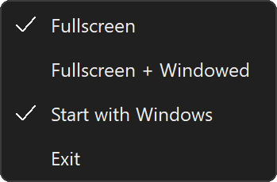

# GsyncStatusTrayToggle

A Windows tray app that shows the NVIDIA G-SYNC state and turns it on or off with one click.

Not affiliated with NVIDIA.

## Features

- Tray icon shows the current state: Off, Fullscreen or Fullscreen + Windowed.
- One-click toggle that follows the NVIDIA Control Panel's sequence.
- Stays in sync with changes made in the NVIDIA Control Panel or other tools.
- Command line support.

| | Off | Fullscreen | Fullscreen + Windowed |
| --- | :---: | :---: | :---: |
| Dark taskbar |  |  |  |
| Light taskbar |  |  |  |

## Requirements

- Windows 10 version 1607 or later, or Windows 11, 64-bit.
- An NVIDIA GPU with a G-SYNC or G-SYNC Compatible display.

## Usage

Download the zip from the Releases page, extract it and run `GsyncStatusTrayToggle.exe`. The program is not signed: if SmartScreen warns, choose **More info**, then **Run anyway**.

- **Left-click:** G-SYNC on or off.
- **Right-click:** Fullscreen, Fullscreen + Windowed, Start with Windows, Exit.



### Command line

| Command | Result |
| --- | --- |
| `GsyncStatusTrayToggle.exe /off` | G-SYNC off |
| `GsyncStatusTrayToggle.exe /fs` | G-SYNC on, fullscreen only |
| `GsyncStatusTrayToggle.exe /fsw` | G-SYNC on, fullscreen and windowed |

| Exit code | Meaning |
| --- | --- |
| 0 | Success |
| 1 | The G-SYNC lock could not be opened |
| 2 | Another G-SYNC command is still running |
| 3 | The G-SYNC lock could not be acquired |
| 10 | NVAPI could not be initialized (NVIDIA driver missing?) |
| 11 | The NVIDIA settings could not be opened |
| 12 | The NVIDIA settings could not be loaded |
| 13 | The NVIDIA global profile could not be opened |
| 14 | A G-SYNC setting could not be read, or its value is unknown. Nothing was changed |
| 15 | NVIDIA rejected the change. Part of it may already be saved |
| 16 | The NVIDIA settings could not be saved. Part of the change may already be saved |
| 17 | Saved, but the result could not be confirmed or the displays could not be redrawn |
| 20 | Internal error |
| 64 | Invalid arguments |

Without arguments, the tray exits with 0, with 1 if it cannot start, or with 20.

### Uninstall

Uncheck Start with Windows, choose Exit, then delete the EXE.

## Build

MSVC x64 and a Windows 11 SDK, from an x64 Native Tools Command Prompt:

```
cl /nologo /O2 /MT /EHsc /std:c++17 /utf-8 /W4 /WX /analyze /DUNICODE tests\GsyncLogicTests.cpp
GsyncLogicTests.exe
rc /nologo GsyncStatusTrayToggle.rc
cl /nologo /O2 /GL /MT /EHsc /std:c++17 /utf-8 /W4 /WX /analyze /analyze:external- /Brepro /DUNICODE /external:anglebrackets /external:W0 /external:I nvapi\include GsyncStatusTrayToggle.cpp GsyncStatusTrayToggle.res /link /SUBSYSTEM:WINDOWS /MACHINE:X64 /LTCG /OPT:REF /OPT:ICF /MANIFEST:NO /DEPENDENTLOADFLAG:0x800 /Brepro /LIBPATH:nvapi\lib\amd64 nvapi64.lib user32.lib shell32.lib advapi32.lib gdi32.lib dwmapi.lib shcore.lib cfgmgr32.lib
```

The build is reproducible: the same source, compiler version and command give the same SHA-256. GitHub builds and tests every change. How the code is organized: [docs/ARCHITECTURE.md](docs/ARCHITECTURE.md).

The NVAPI headers and library are included in `nvapi\` ([NVIDIA/nvapi](https://github.com/NVIDIA/nvapi), MIT license).

## How it works

The tray reads G-SYNC - Application Mode in the NVIDIA global profile through NVAPI. It updates when NVIDIA saves its settings in `%ProgramData%\NVIDIA Corporation\Drs`, which happens for every change, from the NVIDIA Control Panel or any other tool. No administrator rights are needed.

A change writes these settings in the NVIDIA global profile through NVAPI, in the same order as the NVIDIA Control Panel:

| Setting (NVIDIA Profile Inspector) | ID | Off | Fullscreen | Fullscreen + Windowed |
| --- | --- | --- | --- | --- |
| G-SYNC - Application Mode | `0x1194F158` | 0 | 1 | 2 |
| G-SYNC - Application State | `0x10A879CF` | 4 | 0 | 0 |
| G-SYNC - Global Feature | `0x1094F157` | 0 | 1 | 1 |
| G-SYNC - Global Mode | `0x1094F1F7` | 0 | 1 | 2 |
| Preferred Refreshrate | `0x0064B541` | 0 | 1 | 1 |

When G-SYNC is turned on or off, the driver disconnects and reconnects the display. The app waits for it to come back, redraws the displays once, and restores their refresh rate if needed. The Control Panel toggles virtual resolution support instead, which redraws twice and, done from another app, often drops VRR for a moment. A change takes about 3.5 seconds and the screen blinks once.

The selected mode is stored in `HKCU\Software\GsyncStatusTrayToggle`. Start with Windows uses the standard `Run` key.

## AI disclosure

This app was built with the help of AI (Claude, by Anthropic) under the direction of the author.

## License

MIT, see [LICENSE](LICENSE). NVAPI is distributed under NVIDIA's MIT license, see [NOTICE.txt](NOTICE.txt). The icon letters are based on the [Oxanium](https://github.com/sevmeyer/oxanium) font (SIL Open Font License 1.1).

NVIDIA and G-SYNC are trademarks or registered trademarks of NVIDIA Corporation.
