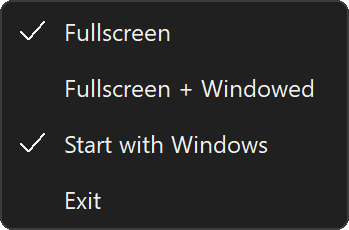

# GsyncStatusTrayToggle

A Windows tray app that shows the NVIDIA G-SYNC state and turns it on or off with one click.

Not affiliated with NVIDIA.

## Features

- Tray icon shows the current state: Off, Fullscreen or Fullscreen + Windowed.
- One-click toggle that follows the NVIDIA Control Panel's sequence.
- Stays in sync with changes made in the NVIDIA Control Panel or other tools.
- Command line support.

| | Off | Fullscreen | Fullscreen + Windowed |
| --- | :---: | :---: | :---: |
| Dark taskbar |  |  |  |
| Light taskbar |  |  |  |

## Requirements

- Windows 10 version 1607 or later, or Windows 11, 64-bit.
- An NVIDIA GPU with a G-SYNC or G-SYNC Compatible display.

## Usage

Download `GsyncStatusTrayToggle.exe` from the Releases page and run it.

- **Left-click:** G-SYNC on or off.
- **Right-click:** Fullscreen, Fullscreen + Windowed, Start with Windows, Exit.



### Command line

| Command | Result |
| --- | --- |
| `GsyncStatusTrayToggle.exe /off` | G-SYNC off |
| `GsyncStatusTrayToggle.exe /fs` | G-SYNC on, fullscreen only |
| `GsyncStatusTrayToggle.exe /fsw` | G-SYNC on, fullscreen and windowed |

Exit code 0 means success. Other codes are listed in `GsyncCore.h`.

### Uninstall

Uncheck Start with Windows, choose Exit, then delete the EXE.

## Build

MSVC x64 and a Windows 11 SDK, from an x64 Native Tools Command Prompt:

```
rc GsyncStatusTrayToggle.rc
cl /std:c++17 /EHsc /O2 /MT /DUNICODE /I nvapi\include GsyncStatusTrayToggle.cpp GsyncStatusTrayToggle.res /link /SUBSYSTEM:WINDOWS /MANIFEST:NO /LIBPATH:nvapi\lib\amd64 nvapi64.lib user32.lib shell32.lib advapi32.lib ole32.lib gdi32.lib dwmapi.lib shcore.lib cfgmgr32.lib
```

The NVAPI headers and library are included in `nvapi\` ([NVIDIA/nvapi](https://github.com/NVIDIA/nvapi), MIT license).

## How it works

The tray reads the driver's registry value `0x1194f158` under `HKLM\SYSTEM\CurrentControlSet\Services\nvlddmkm\State` and updates when it changes.

A change writes these settings in the NVIDIA global profile through NVAPI, in the same order as the NVIDIA Control Panel:

| Setting (NVIDIA Profile Inspector) | ID | Off | Fullscreen | Fullscreen + Windowed |
| --- | --- | --- | --- | --- |
| G-SYNC - Application Mode | `0x1194F158` | 0 | 1 | 2 |
| G-SYNC - Application State | `0x10A879CF` | 4 | 0 | 0 |
| G-SYNC - Global Feature | `0x1094F157` | 0 | 1 | 1 |
| G-SYNC - Global Mode | `0x1094F1F7` | 0 | 1 | 2 |
| Preferred Refreshrate | `0x0064B541` | 0 | 1 | 1 |

When G-SYNC is turned on or off, the driver disconnects and reconnects the display. The app waits for it to come back, redraws the displays once, and restores their refresh rate if needed. The Control Panel toggles virtual resolution support instead, which redraws twice and, done from another app, often drops VRR for a moment. A change takes about 3.5 seconds and the screen blinks once.

The selected mode is stored in `HKCU\Software\GsyncStatusTrayToggle`. Start with Windows uses the standard `Run` key.

## AI disclosure

This app was built with the help of AI (Claude, by Anthropic) under the direction of the author.

## License

MIT, see [LICENSE](LICENSE). NVAPI is distributed under NVIDIA's MIT license, see [NOTICE.txt](NOTICE.txt). The icon letters are based on the [Oxanium](https://github.com/sevmeyer/oxanium) font (SIL Open Font License 1.1).

NVIDIA and G-SYNC are trademarks or registered trademarks of NVIDIA Corporation.
